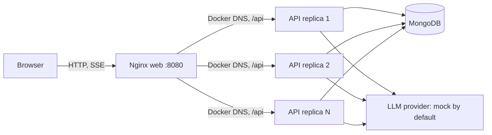

# TDK AI Chat App

A responsive React chat client with a stateless Express API, MongoDB-backed accounts and chat history, and an SSE streaming interface. The default provider is a deterministic mock, so the whole stack works without an external model.

## Architecture



Nginx serves the built SPA and proxies `/api/` to the Compose `api` service. It resolves that service through Docker's embedded DNS at runtime, disables proxy buffering and caching, and uses a long read timeout for SSE. MongoDB uses a named volume. Only nginx publishes a host port (`8080`). The API has no `container_name` or published port, so it can be scaled with Compose.

## Authentication design

- Passwords are hashed with bcrypt (cost 12); login errors are generic. Emails are trimmed and lowercased before storage and lookup.
- The 15-minute HS256 access token stays in frontend memory. The 7-day refresh JWT is stored in an HttpOnly cookie.
- On refresh, the API atomically consumes the old token and returns a replacement. MongoDB stores only SHA-256 token hashes with an expiry TTL index. Logout deletes the active token record. Reuse of a consumed token outside the small concurrent-tab retry window revokes all refresh tokens for that user.
- Missing JWT secrets stop API startup. For production, set separate random values for `JWT_ACCESS_SECRET` and `JWT_REFRESH_SECRET`. `COOKIE_SECURE` controls the refresh cookie's `Secure` flag; if unset, it defaults to true in production and false otherwise. The local Compose example sets `COOKIE_SECURE=false` for HTTP on localhost. Set it to `true` behind HTTPS in any deployed environment.
- Helmet is enabled; CORS allows only `CLIENT_ORIGIN` and credentials. Auth routes are rate-limited. Express trusts one proxy hop (nginx) so rate limits see the forwarded client IP.

Access tokens are not tracked in MongoDB; after logout they may remain usable until their 15-minute expiry. Rate limits use the default in-process `express-rate-limit` store, so counts are per API replica rather than shared across replicas.

## Streaming design

`POST /api/chats/:id/messages` streams SSE frames named by their JSON `type`: `thinking`, `token`, `done`, or `error`. Comment heartbeats keep idle connections alive. The first send can use `:id` equal to `new`; the API creates and titles the chat from the first user message. It validates messages up to 8,000 characters, saves the user message before generation, builds context from the latest 20 database messages, and stores the assistant message once after generation. If the client disconnects or presses Stop, the provider's `AbortSignal` is triggered and partial assistant text is persisted with status `stopped`.

Providers implement `streamChat(messages, { signal })` as an async generator yielding `{ type: "thinking" | "token", text }`. `LLM_PROVIDER=mock` is the default; it emits simulated thinking followed by a word-by-word response. `LLM_PROVIDER=ollama` is not included in this phase. To add a provider, implement that generator in `backend/src/llm/providers/`, register its name in `backend/src/llm/index.js`, honor the signal, and add provider-specific environment settings without changing the route or frontend SSE protocol.

The UI renders Markdown and code blocks, batches token updates with animation frames, shows collapsible thinking, supports stop/retry, and pauses auto-scroll when the reader moves away from the latest message.

## Scaling approach and limits

API containers keep no conversation or session state in process. MongoDB is the shared source of truth for users, refresh-token records, chats, and messages. Nginx discovers API replicas through Docker DNS, so `docker compose up --build --scale api=3` can distribute requests without a manually maintained upstream list. `web` remains a single nginx container in this Compose setup.

Known limits for this take-home scope:

- Rate limiting is per process and can be bypassed across replicas; use a shared store such as Redis for a multi-replica production deployment.
- Existing access JWTs remain valid for up to 15 minutes after logout or refresh-token reuse revocation.
- MongoDB is a single container with one named data volume, not a replica set or managed high-availability database.
- The mock provider is only for development and UX testing. No real LLM provider is configured in this phase.

## Run with Docker Compose

Prerequisites: Docker Engine with the Compose plugin. From the repository root:

```sh
cp .env.example .env
# Replace both JWT secret placeholders in .env with separate random secrets.
docker compose up --build
```

Open [http://localhost:8080](http://localhost:8080), create an account, and send a message. The API is reachable through nginx at the same origin; MongoDB and API ports are not published to the host. Stop the stack with `Ctrl+C`, then `docker compose down`. To also delete the local database volume, use `docker compose down --volumes`.

To scale the API:

```sh
docker compose up --build --scale api=3
```

Nginx access logs include the selected upstream address; inspect them with `docker compose logs -f web` to see requests routed to different API container IPs. The API replica names and addresses are available through `docker compose ps` and `docker inspect`.

## Local development

Use Node.js 26 (`nvm use` reads `.nvmrc`), run MongoDB locally, and set `MONGO_URI` to your local Mongo instance and `CLIENT_ORIGIN=http://localhost:5173` in `.env`. Install and start each app in separate terminals:

```sh
cd backend && npm ci && npm run dev
cd frontend && npm ci && npm run dev
```

The API runs on `http://localhost:4000`; Vite runs on `http://localhost:5173`.

## Tests and manual verification

Run the backend test suite:

```sh
cd backend && npm test
```

Tests use `mongodb-memory-server`, not the local MongoDB data. The first run may download a MongoDB test binary. Coverage includes signup/login/refresh/logout and refresh-token reuse/concurrency, protected routes and expired/missing access tokens, chat ownership for read/rename/delete, SSE event sequence, abort persistence, and stream ownership.

For a quick container check after starting Compose:

```sh
curl -i http://localhost:8080/api/health
```

To observe SSE frames without curl output buffering, authenticate in the app and send a message, or use `curl -N` with a valid bearer access token against `POST http://localhost:8080/api/chats/new/messages` and JSON `{"content":"Explain streaming briefly"}`.

## Container details and trade-offs

The backend uses a multi-stage `node:26-alpine` image. The build stage includes the compiler toolchain for native modules; the runtime stage contains only production dependencies and the shared C++ runtime, runs as the unprivileged `node` user, and has an HTTP health check. `backend/package.json` pins approval of bcrypt 6.0.0's install script because it provides the native password-hashing module. The frontend builds with Vite and serves `dist` from `nginx:alpine`; nginx provides SPA fallback and SSE proxy settings.

The mock provider makes streaming deterministic and avoids requiring credentials. This keeps the assignment runnable offline but does not demonstrate model quality, model-provider retries, or provider-specific throttling. Reasonable next steps are a real provider adapter, a shared rate-limit store, MongoDB replica set/managed deployment, structured request tracing, and production secret management.
